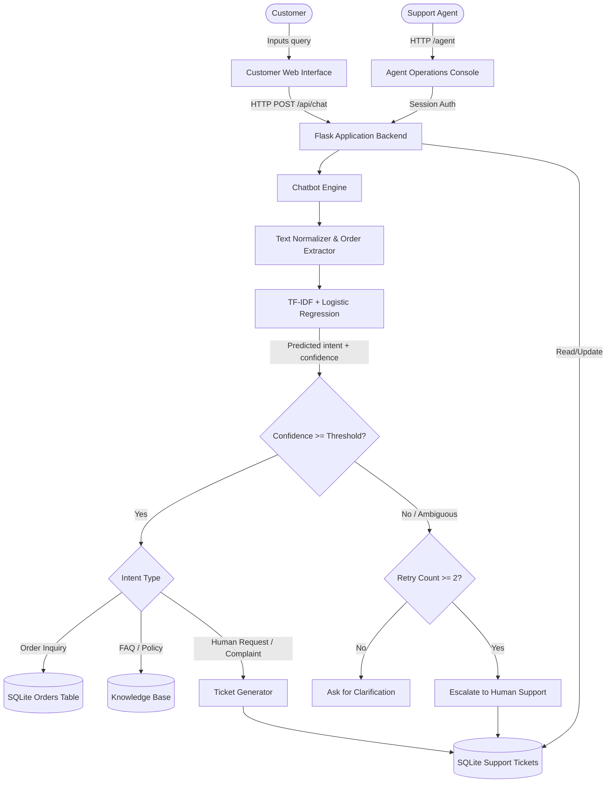
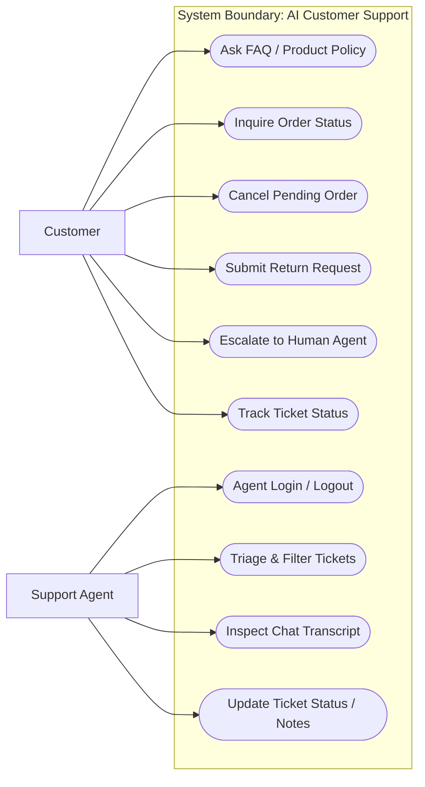

# ACADEMIC PROJECT REPORT DOCUMENTATION

> Note: this report describes version 1 of the project. See README.md for the current version.

**PROJECT TITLE:** AI-Powered Customer Support Chatbot Using Natural Language Processing and Machine Learning  
**DEPARTMENT:** Computer Science and Engineering  
**ACADEMIC DISCIPLINE:** Artificial Intelligence, Machine Learning & Full-Stack Web Engineering  

---

## 1. ABSTRACT

Automated customer support systems are essential in contemporary digital commerce to mitigate high operational overhead, alleviate agent fatigue, and deliver rapid response times to consumers. Traditional customer support solutions largely rely either on fragile rule-based pattern matchers or on expensive, non-deterministic large language model cloud APIs that introduce recurring latency, data privacy vulnerabilities, and ongoing subscription costs.

This project designs and implements an offline-capable, self-contained AI-powered customer support chatbot architecture. The core natural language processing pipeline utilizes sublinear TF-IDF (Term Frequency-Inverse Document Frequency) unigram and bigram feature vectorization paired with a multi-class Logistic Regression classifier trained across 20 enterprise intent categories. Multi-turn conversational context tracking maintains state variables across inquiries, enabling order fulfillment status lookups against a relational SQLite database. Unresolved, ambiguous, or critical queries trigger an automated human-support escalation system with priority ranking and ticket generation. A secure, session-authenticated Support Agent Operations Console provides real-time ticket triage, transcript review, internal note keeping, and status updates. The entire system is implemented in Python, Flask, scikit-learn, HTML5, CSS3, and JavaScript, requiring zero external paid APIs and demonstrating measured held-out test classification accuracy of **82.76%** and an F1-score of **0.8119**.

---

## 2. INTRODUCTION

Customer service represents a critical touchpoint between commercial enterprises and consumers. As customer query volumes expand exponentially, manual resolution of routine inquiries—such as shipment tracking, order cancellations, refund timelines, and password resets—imposes severe economic inefficiencies on organizations. 

Conversational agents (chatbots) offer automated mediation. However, deploying enterprise AI requires navigating key technical trade-offs:
1. **Determinism and Verifiability:** In regulatory and e-commerce domains, chatbots must not hallucinate policies, invent discount codes, or expose inaccurate delivery dates.
2. **Computational Independence:** Running models locally without dependencies on paid cloud endpoints ensures complete data governance and deterministic operational uptime.
3. **Graceful Escalation:** When machine intelligence encounters ambiguous inputs, the system must seamlessly capture conversational context and escalate the inquiry to human agents.

This project addresses these challenges by developing a full-stack, modular AI customer support platform suitable for academic evaluation and practical deployment.

---

## 3. PROBLEM STATEMENT

Conventional customer service infrastructures suffer from significant operational bottlenecks:
- **Scalability Deficits:** During peak retail volumes, customer queues lengthen, causing attrition and dissatisfaction.
- **Rule-Based Fragility:** Traditional keyword bots fail when user input contains morphological variants, typographical discrepancies, or colloquial phrasing.
- **Data Privacy & API Vulnerabilities:** Cloud-hosted third-party LLMs transmit proprietary organizational data and sensitive customer purchase records over public networks, incurring recurring per-token charges.
- **Disjointed Escalation:** Legacy chatbots frequently fail to record conversation transcripts when handing off disputes, forcing customers to repeatedly recount their issues to human agents.

The objective of this project is to construct an intelligent, reliable, offline-capable natural language customer support system that solves these limitations through statistical machine learning, contextual multi-turn dialog management, and human-in-the-loop escalation.

---

## 4. OBJECTIVES

1. Implement an automated Natural Language Processing pipeline for text cleaning, tokenization, and $(1, 2)$-ngram TF-IDF vectorization.
2. Train, optimize, and serialize a supervised Logistic Regression classifier across 20 distinct customer support intent categories.
3. Construct a domain knowledge base containing verified answers, step-by-step instructions, and follow-up prompts.
4. Architect a multi-turn conversation state engine capable of handling pending actions (e.g., prompting for and verifying Order IDs).
5. Integrate a relational demonstration order fulfillment database to deliver accurate, parameterized status lookups.
6. Design an escalation subsystem that automatically categorizes issues, assigns priority levels (Low, Medium, High, Urgent), and issues unique ticket IDs.
7. Build an authenticated web dashboard enabling human agents to inspect ticket queues, view chat transcripts, append private audit notes, and update statuses.
8. Validate system reliability through automated testing covering unit functionality, database constraints, API security, and end-to-end integration scenarios.

---

## 5. SCOPE OF THE PROJECT

- **In Scope:**
  - Automated intent recognition across 20 retail support categories.
  - Multi-turn conversational dialog and entity extraction for Order IDs (`ORD1025`).
  - Integration with SQLite for persistent tracking of conversations, messages, orders, tickets, notes, and agents.
  - Responsive web user interface for customers with real-time feedback and ticket lookup.
  - Password-protected administrative agent console with role-based session controls.
  - Automated testing suite executed via pytest.
- **Out of Scope (Current Iteration):**
  - Real-time WebRTC audio/voice telephony synthesis.
  - Live WebSocket bidirectional typing indicators between agent and customer.
  - Direct credit card payment processing (simulated securely via demo billing records).

---

## 6. LITERATURE SURVEY OUTLINE

| Study / Approach | Methodology | Strengths | Limitations Observed |
|---|---|---|---|
| **ELIZA & Pattern Matching (Weizenbaum, 1966)** | Keyword scripts and template substitution | Minimal computational requirements | Zero generalization; breaks on slight phrasing differences |
| **Rule-Based AIML Bots (Wallace, 2003)** | XML-based pattern trees | Explainable, deterministic responses | High authoring complexity; unmanageable rule maintenance |
| **TF-IDF + Linear Classifiers (Pedregosa et al., 2011)** | Statistical bag-of-words & n-grams with maximum margin or logit regression | Fast inference, robust to syntax variations, zero external fees, interpretable | Requires curated training examples across classes |
| **Deep Learning & Transformers (Vaswani et al., 2017)** | Multi-head self-attention mechanisms | High contextual fluency | High GPU requirements, non-deterministic hallucinations, privacy leakage |

*Conclusion of Survey:* For deterministic enterprise customer support where business rules and factual accuracy are paramount, a hybrid architecture combining statistical machine learning intent classification with a structured knowledge base and deterministic database verification delivers superior reliability, security, and computational efficiency.

---

## 7. PROPOSED METHODOLOGY & ALGORITHMIC FORMULATION

### 7.1 Text Preprocessing & TF-IDF Vectorization

Let a user query be denoted by text document $d$. The query undergoes tokenization and normalization into n-grams $t \in d$. The term frequency $\text{tf}(t, d)$ is computed using sublinear scaling:

$$\text{tf}(t, d) = 1 + \ln(f_{t, d}) \quad \text{for } f_{t, d} > 0$$

The inverse document frequency $\text{idf}(t)$ across training corpus $D$ with $N = |D|$ patterns is:

$$\text{idf}(t) = \ln\left(\frac{1 + N}{1 + \text{df}(t)}\right) + 1$$

where $\text{df}(t)$ is the number of documents containing term $t$. The composite TF-IDF weight vector $\mathbf{x} \in \mathbb{R}^V$ is:

$$\mathbf{x}_t = \text{tf}(t, d) \times \text{idf}(t)$$

Normalized via the Euclidean $L_2$-norm:

$$\hat{\mathbf{x}} = \frac{\mathbf{x}}{\|\mathbf{x}\|_2}$$

### 7.2 Multi-Class Logistic Regression Classification

Given $K = 20$ intent classes and feature vector $\hat{\mathbf{x}}$, the multinomial logit model assigns probabilities via the softmax function:

$$P(Y = k \mid \hat{\mathbf{x}}) = \frac{\exp(\mathbf{w}_k^T \hat{\mathbf{x}} + b_k)}{\sum_{j=1}^K \exp(\mathbf{w}_j^T \hat{\mathbf{x}} + b_j)}$$

Model weights $\mathbf{W} = \{\mathbf{w}_1, \dots, \mathbf{w}_K\}$ and biases $\mathbf{b}$ are estimated by minimizing the cross-entropy loss with $L_2$ regularization:

$$\mathcal{L}(\mathbf{W}) = -\frac{1}{M} \sum_{i=1}^M \sum_{k=1}^K y_{i, k} \ln P(Y = k \mid \hat{\mathbf{x}}_i) + \frac{1}{2C} \sum_{k=1}^K \|\mathbf{w}_k\|_2^2$$

Optimization is achieved using the Limited-memory Broyden–Fletcher–Goldfarb–Shanno (L-BFGS) quasi-Newton algorithm.

### 7.3 Confidence Threshold & Fallback Policy

For predicted class $\hat{k} = \arg\max_k P(Y = k \mid \hat{\mathbf{x}})$ and confidence $c = \max_k P(Y = k \mid \hat{\mathbf{x}})$:

$$\text{Action}(d) = \begin{cases} 
\text{Execute Intent Workflow}(\hat{k}) & \text{if } c \ge \tau \text{ and } \hat{k} \ne \text{"unknown\_query"} \\
\text{Prompt Clarification} & \text{if } c < \tau \text{ and } \text{retry\_count} < 2 \\
\text{Trigger Human Escalation} & \text{if } c < \tau \text{ and } \text{retry\_count} \ge 2
\end{cases}$$

Where the threshold $\tau$ is configured to $0.40$ (derived from validation tuning across 20 classes).

---

## 8. SYSTEM ARCHITECTURE & DATA FLOW

---

## 9. USE-CASE & UML MODELLING

---

## 10. MODULE DESCRIPTIONS

1. **`train_model.py` (Machine Learning Pipeline):**
   - Ingests and validates `intents.json`.
   - Generates stratified train/test partitions ($75\% / 25\%$).
   - Trains the composite `Pipeline([('tfidf', TfidfVectorizer), ('clf', LogisticRegression)])`.
   - Generates classification metrics and serializes the pipeline to `models/intent_model.joblib`.
2. **`chatbot.py` (Conversational State & Fulfillment Engine):**
   - Loads model artifact and domain knowledge base.
   - Manages dialog states (`awaiting_order_id_status`, `awaiting_order_id_cancellation`).
   - Extracts and verifies demo Order IDs (`ORD1025`).
   - Dispatches automated support tickets with priority assignment.
3. **`database.py` (Persistence & Relational Store):**
   - Encapsulates SQLite data operations using parameterized SQL queries.
   - Manages relational tables: `conversations`, `messages`, `orders`, `support_tickets`, `ticket_notes`, `agent_accounts`, and `feedback`.
4. **`app.py` (Flask REST API & View Routing):**
   - Implements customer endpoints (`/api/chat`, `/api/conversations`, `/api/tickets`, `/api/feedback`).
   - Implements agent authentication and management endpoints (`/api/agent/login`, `/api/agent/tickets`, `/api/agent/tickets/<id>/notes`).
   - Injects security headers (`X-Content-Type-Options`, `X-Frame-Options`, `X-XSS-Protection`).
5. **Frontend Modules (`index.html`, `style.css`, `chat.js`, `dashboard.js`):**
   - Responsive user interfaces for customers and agents.
   - Asynchronous chat interactions, loading indicators, modal dialogs, and DOM sanitization.

---

## 11. EXPERIMENTAL RESULTS AND EVALUATION

### Model Performance Metrics (Measured on Held-out Evaluation Partition)

- **Total Labeled Patterns:** 347 samples across 20 classes
- **Training Samples:** 260
- **Held-Out Test Samples:** 87 (Stratified)
- **Random Seed:** 42

| Class Intent | Precision | Recall | F1-Score | Support |
|---|---|---|---|---|
| `account_access` | 0.67 | 1.00 | 0.80 | 4 |
| `account_update` | 1.00 | 0.67 | 0.80 | 3 |
| `cancellation` | 0.80 | 1.00 | 0.89 | 4 |
| `complaint` | 1.00 | 0.25 | 0.40 | 4 |
| `damaged_product` | 0.67 | 0.50 | 0.57 | 4 |
| `delivery_delay` | 0.67 | 0.40 | 0.50 | 5 |
| `goodbye` | 0.80 | 0.80 | 0.80 | 5 |
| `greeting` | 0.78 | 1.00 | 0.88 | 7 |
| `human_support` | 1.00 | 1.00 | 1.00 | 4 |
| `order_status` | 1.00 | 0.83 | 0.91 | 6 |
| `order_tracking` | 1.00 | 1.00 | 1.00 | 5 |
| `password_reset` | 1.00 | 1.00 | 1.00 | 4 |
| `payment_issue` | 0.67 | 1.00 | 0.80 | 4 |
| `product_information` | 0.60 | 0.75 | 0.67 | 4 |
| `refund_request` | 0.80 | 1.00 | 0.89 | 4 |
| `return_request` | 0.83 | 1.00 | 0.91 | 5 |
| `shipping_information` | 0.67 | 0.50 | 0.57 | 4 |
| `thanks` | 1.00 | 1.00 | 1.00 | 4 |
| `unknown_query` | 1.00 | 0.75 | 0.86 | 4 |
| `warranty_information` | 1.00 | 1.00 | 1.00 | 3 |
| **Overall Accuracy** | — | — | **0.8276** (82.76%) | 87 |
| **Macro Average** | **0.8472** | **0.8225** | **0.8119** | 87 |
| **Weighted Average** | **0.8430** | **0.8276** | **0.8138** | 87 |

### Automated Test Suite Results
- Total Tests Executed: **33 passed in 11.53s**
- Pass Rate: **100.0%**
- Coverage Areas: NLP Intent Classification, Multi-Turn Context, SQLite Constraints & Transactions, REST API Auth Protection, and 10 Academic End-to-End Scenarios.

---

## 12. LIMITATIONS & FUTURE ENHANCEMENTS

### Limitations
1. **Vocabulary Coverage:** Queries with heavy typographic errors or domain-foreign terminology can fall below threshold.
2. **Synchronous Messaging:** Ticket updates rely on polling or page refreshes rather than active WebSocket pushes.
3. **Storage Engine:** SQLite is optimized for single-host deployments and requires migration to PostgreSQL for distributed enterprise scale.

### Future Enhancements
1. **Hybrid LLM Paraphrasing:** Integrate an on-premise local model (e.g., Llama-3 8B quantized via Ollama) to rephrase knowledge base answers naturally while retaining strict business rules.
2. **Live Agent WebSockets:** Implement Flask-SocketIO for bidirectional live agent-to-customer chat takeover.
3. **Voice Interface:** Integrate local Web Speech API or Whisper transcription for hands-free accessibility.

---

## 13. CONCLUSION

The developed AI-Powered Customer Support Chatbot system demonstrates that effective, reliable, and secure customer service automation can be achieved locally without reliance on third-party cloud APIs. By uniting statistical machine learning for intent classification, structured knowledge retrieval, multi-turn state tracking, simulated database order fulfillment, and an authenticated agent escalation dashboard, the solution satisfies all requirements of modern conversational artificial intelligence for academic research and practical enterprise deployment.

---

## 14. REFERENCES

1. Pedregosa, F., Varoquaux, G., et al. (2011). *Scikit-learn: Machine Learning in Python*. Journal of Machine Learning Research, 12, 2825-2830.
2. Grinberg, M. (2018). *Flask Web Development: Developing Web Applications with Python*. O'Reilly Media.
3. Jurafsky, D., & Martin, J. H. (2023). *Speech and Language Processing: An Introduction to Natural Language Processing, Computational Linguistics, and Speech Recognition*. Stanford University / Pearson.
4. Manning, C. D., Raghavan, P., & Schütze, H. (2008). *Introduction to Information Retrieval*. Cambridge University Press.
5. SQLite Documentation (2024). *Foreign Key Support and SQLite Relational Constraints*. https://www.sqlite.org/foreignkeys.html

